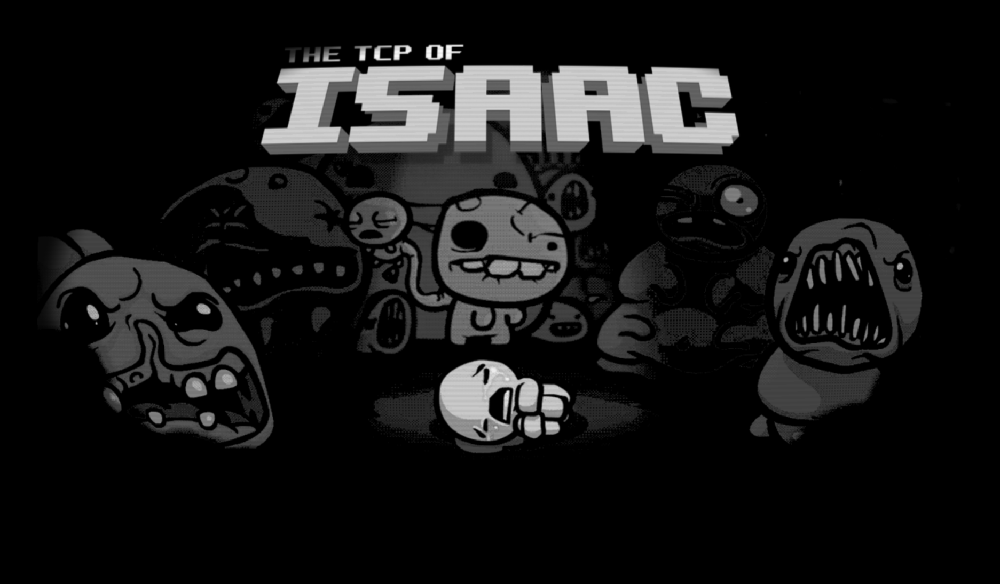
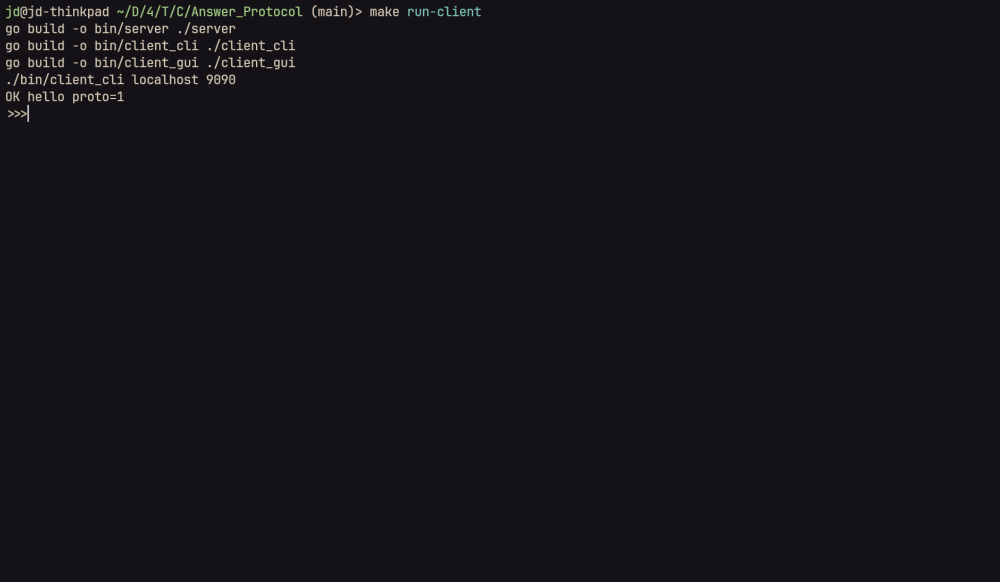
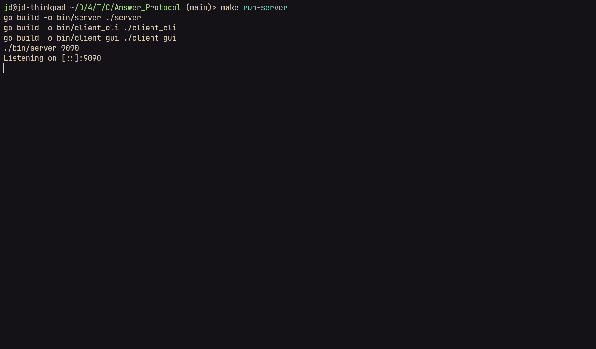

*This project has been created as part of the 42 curriculum by jogamber, nisalmon, erifflar.*

<p align="center">
  
  
  
</p>


# TAP — The Answer Protocol

A shared-world, retro-style multiplayer text adventure (MUD) built around a custom line-based TCP protocol (RFC 42TAP), themed after *The Binding of Isaac*. The project ships a Go TCP server, a command-line client, and a graphical client built with Fyne.

## Description

Players connect to a persistent-feeling dungeon, pick a character, explore rooms, chat, fight enemies, complete quests, and cooperate with other players in real time. The server is the single source of truth for the entire game world — both clients are thin: they hold no game logic of their own and only render what the server tells them, discovering the map progressively (fog-of-war) as they explore.

## Instructions

### Requirements

- Go 1.22 or newer
- A C compiler and standard graphics libraries (required by the Fyne GUI toolkit — `wayland`, `libxkbcommon`, `mesa`, `libglvnd` on Linux)

### Quick start

```bash
make install             # fetch dependencies
make build                 # builds server, CLI client and GUI client into ./bin
make run-server          # starts the server on $(PORT), default 9090
make run-client           # starts the CLI client, connecting to $(IP):$(PORT)
make run-client-gui        # starts the GUI client, connecting to $(IP):$(PORT)
```

Override the target host/port inline, e.g.:

```bash
make run-client IP=127.0.0.1 PORT=9090
```

## Resources

- [RFC 42TAP protocol specification] (provided with the subject)
- Go standard library documentation: `net`, `bufio`, `encoding/json`, `sync`
- [Fyne documentation](https://docs.fyne.io) for the GUI client
- **AI usage**: Claude (Anthropic) was used throughout the project as a learning and debugging aid — explaining Go concepts (goroutines, channels, closures, slices) before implementation

## Architecture

The server follows a single-writer / hub pattern to avoid manual locking of the game state:

- **One `hub` goroutine** owns all shared mutable state (`online_players`, `rooms`, `quests`) and is the *only* goroutine that reads or writes it directly. Every client command is sent to the hub as a `Message{From, Text, ReplyChan}` over a channel and processed sequentially — this guarantees no two commands can race on the world state, without needing mutexes on those structures.
- **Two goroutines per connection**: one reads incoming client commands and forwards them to the hub; a second, independent one drains the connection's `Session.Events` channel and writes any pushed `EVT ...` line (chat, presence, stats) to the socket as soon as it's available — this is what allows asynchronous events to reach a client even while it isn't actively sending a command.
- **`sessions` (connection → username/character/group/events)** is shared across goroutines and is the one structure still accessed outside the hub (by the per-connection event-listener goroutine), so it is a known area for future hardening with a `sync.RWMutex`.
- **Panic isolation**: command dispatch runs inside a `defer/recover` wrapper, so a bug in any single command handler returns `ERR 500 INTERNAL_ERROR` to that one client instead of crashing the server for everyone.
- **Clients are thin**: the GUI and CLI hold no authoritative game state. Room/inventory/status data is always re-fetched from the server (`LOOK`, `INVENTORY`, `STATUS`, `WHO`) rather than cached and trusted long-term.

## Protocol Implementation

The implementation follows RFC 42TAP as the authoritative specification. A few deviations were introduced where the RFC was silent or where the example transcripts in the subject PDF conflicted with the RFC itself:

- **`WHO`**: the subject PDF's example shows a room-scoped JSON payload (`{"room": [...], "server": N}`), but this contradicts the RFC, which defines `WHO` as `OK players=<count>` (a global connected-player count only). We followed the RFC. Room occupancy is instead read from the `players` array already returned by `LOOK`.
- **`LOOK` — extended `players` field**: each entry is `{"name": ..., "character": ...}` instead of a bare name string. Neither `LOOK` nor `WHO` in the RFC exposes which character another player is playing, which the GUI needs to render the correct portrait for other players in the room.
- **Item representation**: `LOOK`, `INVENTORY` and `TAKE`/`DROP` responses use `{"id": "item.xxx", "name": "..."}` objects instead of bare ID strings. `TAKE`/`DROP`/`USE` accept either the ID or the display name (including multi-word names). IDs are generated automatically from item names at world-load time.
- **`USE <item>` command** (not defined by the RFC, mentioned as an example extension point in RFC §6.1.1): additional error `ERR ITEM_NOT_USABLE`. Currently used by the `Map` item, which reveals the full room graph (names and exits only — never room contents) without requiring the player to physically visit every room.
- **`GROUP`** implements all four RFC subcommands: `CREATE`, `INVITE`, `JOIN`, `LEAVE`.
- **Error codes** implemented: `201 NAME_IN_USE`, `301 NO_EXIT`, `401 NOT_IN_GROUP`, `402 ALREADY_IN_GROUP`, `404 ITEM_NOT_FOUND` / `NPC_NOT_FOUND` / `ITEM_NOT_IN_INVENTORY`, `405 NPC_NOT_HOSTILE` / `QUEST_NOT_FOUND_OR_NOT_COMPLETED`, `406 NO_QUEST_AVAILABLE`.
- **Multiple commands per TCP packet / commands split across packets**: handled natively by `bufio.Reader.ReadBytes('\n')` buffering — no custom framing or delimiter was needed on top of the RFC's newline-terminated lines. Verified with `printf "CONNECT alice\nLOOK\n" | nc <host> <port>`.

## Combat System

Turn-based, resolved server-side in a single exchange per `ATTACK`:

1. `ATTACK <npc>` deals `damage = ATK * DMG_Mult` to the targeted NPC.
2. If the NPC's HP drops to 0 or below, it is removed from the room permanently.
3. Otherwise, the NPC immediately counter-attacks: a random player currently in the same room takes `npc.ATK` damage, reduced by that player's `Damage_Reduction` (a "counter-attack" is not guaranteed to hit the original attacker — any player sharing the room can be targeted, reflecting a shared threat).
4. `DEFEND` sets the caller's `Damage_Reduction` to 0.25 (25% mitigation on the next hit taken).
5. `STATUS` reports `hp`, `max_hp`, `atk`, `coin`, `bomb`, `key`, and a narrative `status` string derived from HP percentage thresholds (≥80% "healthy!", ≥50% "could be better.", ≥30% "death seems inevitable...", below that a final warning).
6. Attacking a non-hostile NPC returns `ERR 405 NPC_NOT_HOSTILE`; an unknown target returns `ERR 404 NPC_NOT_FOUND`.

Respawn-on-death and further combat balancing are tracked as follow-up work (see `todo.md`).

## Quest System

Quests are static data loaded from `data/quests.json`, of two types:

- **`item`**: requires turning in a given quantity of a resource (`coin`, `bomb`, or `key`).
- **`ennemy`**: requires a specific named NPC (e.g. the final boss `Mom`) to no longer exist anywhere in the world.

Flow:

1. `QUEST <npc name>` picks up the quest linked to that NPC (server-side, each quest instance can only be taken once globally — `quests.Quest[k].taken`). Returns `ERR 406 NO_QUEST_AVAILABLE` if already taken, `ERR 404 NPC_NOT_FOUND` if the NPC doesn't exist.
2. `QUESTS` lists the caller's currently active (taken, not yet completed) quests.
3. Completion is evaluated lazily whenever `COMPLETE_QUEST <name>` is called: item quests check the player's current resource count against the required amount; enemy quests check whether the target NPC is still alive anywhere in the world.
4. On success, the player receives the quest's reward (`coin`/`bomb`/`key` counters, or a named inventory item) and the quest is marked finished. Returns `ERR 405 QUEST_NOT_FOUND_OR_NOT_COMPLETED` otherwise.

## World Design

A 37-room dungeon (`data/world_map.json`) laid out on a North/South/East/West grid, forming multiple loops with several dead-end branches (satisfying the "no line-only map" requirement). Room names and flavor text follow a *Binding of Isaac* theme.

- **NPCs (23 total)**, covering all three required roles:
  - *Dialogue-only*: `Shop Keeper`, `Wandering Soul`
  - *Quest-givers*: `Ryan` (item quest), `Guppy`
  - *Hostile* (19): regular mobs (5–15 HP), three mid-bosses (`Larry Jr.`, `Gemini`, `The Duke of Flies`, 60–90 HP), and the final boss `Mom` (300 HP) in the most remote room of the map.
- **Items (20 distinct)**, spread across two dedicated item rooms plus scattered single pickups, including the special `Map` item (see Protocol Implementation).
- **Exploration is fog-of-war on the client side**: the GUI never preloads the world file — it only learns a room's name, exits, items, and NPCs through the server's `LOOK` response (or the `Map` item's room-graph reveal, which never exposes contents). This preserves the "server is the single source of truth" principle end-to-end.

## Server Logging

`server/logger.go` writes one structured JSON line per event (`{"time", "level", "event", "details"}`) simultaneously to `stdout` and `logs/server.log`, guarded by a mutex for safe concurrent writes.

- **Levels**: `INFO` (connections, commands received/sent, world-state changes such as item pickup/drop, quest progress, NPC dialogue), `WARN` (detected abuse), `ERROR` (technical failures, recovered panics).
- **Abuse detection** (`server/abuse.go`): a sliding-window rate tracker per connection/IP flags more than 15 commands within 2 seconds, or more than 5 new connections within 5 seconds from the same IP. Both thresholds are adjustable constants and are logged at `WARN` level rather than actively blocking the client, to avoid disconnecting legitimate bursts of activity (e.g. a client replaying several queued commands after a reconnect).

## Group Contributions

| Member | Contributions |
|---|---|
| **jogamber** | TCP server core & connection handling, structured logging and abuse detection, CLI client, GUI client (assets, theme) |
| **nisalmon** | RFC-compliant protocol handler functions (command parsing and response formatting), protocol/RFC compliance fixes, GUI networking, minimap|
| **erifflar** | In-game object and item mechanics (combat and item-related gameplay logic) |

All members have commits in the repository; work was coordinated live throughout development.

## Building and Running

Build tool: **GNU Make**, wrapping `go build`.

| Command | Effect |
|---|---|
| `make install` | Download dependencies from go.mod |
| `make build` | Compiles `bin/server`, `bin/client_cli`, `bin/client_gui` |
| `make run-server` | Builds, then runs the server on `$(PORT)` (default `9090`) |
| `make run-client` | Builds, then runs the CLI client against `$(IP):$(PORT)` |
| `make run-client-gui` | Builds, then runs the GUI client against `$(IP):$(PORT)` |
| `make lint` | Runs `go vet ./...` |
| `make clean` | Removes `bin/` |

## Testing

- **Multiplayer / room presence**: run `make run-server`, then multiple `make run-client` / `make run-client-gui` instances; verify `WHO`, room-scoped `LOOK`, and pushed `EVT ROOM PRESENCE ENTER/LEAVE` events stay consistent as players move between rooms.
- **Chat scopes**: verify `CHAT GLOBAL|ROOM|GROUP <message>` is only delivered to the intended audience, using several simultaneous clients.
- **Multiple commands in one TCP packet**: `printf "CONNECT alice\nLOOK\n" | nc <host> <port>` — confirms `bufio` buffering processes both commands correctly without extra framing.
- **Combat**: attack a shared-room enemy from two clients to confirm HP updates and counter-attacks stay consistent; attack a non-hostile NPC to confirm `ERR 405 NPC_NOT_HOSTILE`.
- **Quests**: pick up, partially progress, and complete both quest types (`item` and `ennemy`) end-to-end.
- **Malformed input**: send commands with missing arguments, unknown commands, and unauthenticated commands (before `CONNECT`) to confirm clean `ERR` responses rather than a crash.
